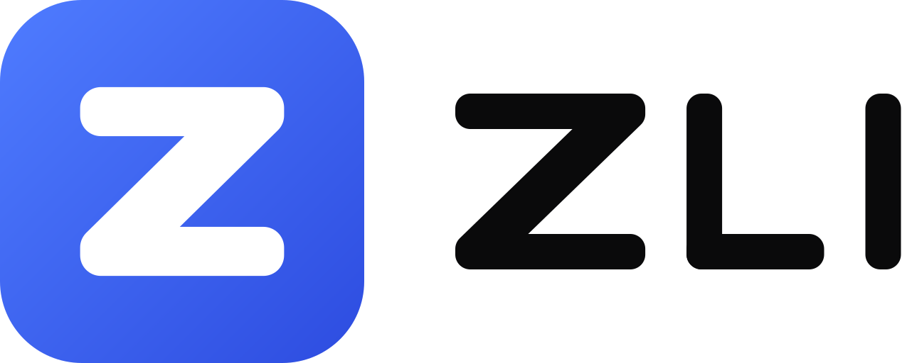

<p align="center">
  <picture>
    <source media="(prefers-color-scheme: dark)" srcset="v2/branding/zli-logo-light.svg">
    
  </picture>
</p>

<p align="center">
  A desktop workspace for running several coding agents on one repository.
</p>

<p align="center">
  <a href="https://github.com/RosMengHeang/ZLI/releases/latest"></a>
  <a href="LICENSE"></a>
  
</p>

## Overview

ZLI puts your agent CLIs side by side in one window. Each agent works in its own Git worktree and terminal, so several can change the same project at once without stepping on each other. When they finish, you review their changes, compare results, and merge the one you want.

## Features

- **Agents side by side.** Run Claude Code, Codex, Cursor CLI, Droid, OpenCode, Gemini CLI, GitHub Copilot CLI, Kimi, Qwen Code, and Goose in a grid of tiles. Each tile switches between the agent's terminal and a chat view.
- **A worktree per agent.** New agents can start in their own worktree and branch. A `zli.json` file in the repository copies files such as `.env` into each worktree and runs setup commands after asking you first.
- **Best of N.** Send one message to two to four agents at once, compare what each one changed, and keep the best run.
- **Review and merge.** See every change with line counts, leave notes for the agent, commit, and merge a worktree back into its branch.
- **Built-in browser.** A Chromium panel scoped to each worktree, which agents can also open and test pages in.
- **Integrations.** Connect services such as GitHub, Linear, Vercel, and Supabase, add any MCP server, and install Claude Code or Codex plugins. Every agent ZLI starts can use them.
- **Skills, prompts, and issues.** Share skills and saved prompts across agents, and start work from GitHub or Linear issues.
- **Multiple accounts.** Sign in to the same agent CLI with more than one account and choose one per agent.

## Install

Download the installer for your platform from the [latest release](https://github.com/RosMengHeang/ZLI/releases/latest).

| Platform | File | First launch |
| --- | --- | --- |
| Windows | `ZLI-<version>-win-x64.exe` | The installer is not code signed yet. If SmartScreen warns about it, choose **More info**, then **Run anyway**. |
| macOS (Apple silicon) | `ZLI-<version>-mac-arm64.dmg` | The app is not signed or notarized yet. Right-click ZLI in Applications, choose **Open**, then confirm **Open**. |
| Linux (Debian, Ubuntu) | `ZLI-<version>-linux-amd64.deb` | Install with `sudo apt install ./ZLI-<version>-linux-amd64.deb`. This adds a menu entry and a `zli` command. |
| Linux (Fedora, RHEL) | `ZLI-<version>-linux-x86_64.rpm` | Install with `sudo dnf install ./ZLI-<version>-linux-x86_64.rpm`. This adds a menu entry and a `zli` command. |
| Linux (AppImage) | `ZLI-<version>-linux-x86_64.AppImage` | Make the file executable with `chmod +x`, then run it. |

ZLI runs the agent CLIs you already have installed. Install and sign in to at least one of them before you start.

### Updates

ZLI checks GitHub Releases a few seconds after it starts and every four hours after that.

- **Windows and Linux (AppImage):** the new version downloads in the background and **Restart to update** appears in the title bar. Otherwise it installs the next time you quit. If agents are still working when you restart, ZLI asks first. To download updates only when you choose, turn off **Install updates automatically** in **Settings > Updates**.
- **Linux (.deb and .rpm):** these packages do not update themselves. Download the new `.deb` or `.rpm` from the release page and install it again with `apt` or `dnf`.
- **macOS:** ZLI tells you when a new version is out and opens the release page, because macOS only lets signed apps update themselves.

**Settings > Updates** and **Help and diagnostics** show the running version and let you check for updates by hand. After an update, ZLI shows what changed.

## Development

### Requirements

- Node.js 24
- pnpm 10.34.9, through Corepack
- Git

### Setup

```sh
corepack enable
pnpm --dir v2 install --frozen-lockfile
```

### Commands

Run these from the repository root. They forward to the pnpm workspace in [`v2/`](v2/).

| Command | What it does |
| --- | --- |
| `npm run dev` | Builds and starts the desktop app. |
| `npm run verify` | Checks import boundaries, formatting, lint, unit tests, and types. |
| `npm run build` | Builds the desktop app and the renderer. |
| `npm run desktop:dir` | Creates an unpacked app for local testing. |
| `npm run desktop:pack` | Creates an installer for the current platform. |
| `npm run e2e` | Runs the end-to-end tests against the real desktop app. |

### End-to-end tests

The Playwright tests drive the packaged Electron app and run only when `ZLI_RUN_E2E` is set.

```sh
# Bash
ZLI_RUN_E2E=1 npm run e2e
```

```powershell
# PowerShell
$env:ZLI_RUN_E2E = "1"
npm run e2e
```

On Linux without a display, run them under `xvfb-run -a`.

## Releases

Every merge to `main` publishes a new patch release through the [Release workflow](.github/workflows/release.yml):

1. Runs the pull request checks from the [ZLI V2 desktop workflow](.github/workflows/v2-desktop.yml) on Windows, macOS, and Linux: `pnpm audit --audit-level high`, `pnpm run verify`, the installers build, and the Electron journey. It stops if any of them fail.
2. Takes the next version from the highest `vX.Y.Z` tag, tags the merge commit, and creates a draft release with generated notes.
3. Builds the installers and update files (`latest*.yml`, `.blockmap`) on each platform, including the Linux `.deb` and `.rpm`, uploads them to the draft, and publishes it once every file is there.

The `package.json` files on `main` stay at `0.0.0`. The build jobs write the release version into them.

- A push is not released when every changed file is Markdown or under a `docs/` folder, or when the head commit message contains `[skip release]`.
- For a minor or major release, run the **Release** workflow from the Actions tab and pick the bump.
- Releases run one at a time, so two quick merges never get the same version.

To build installers locally without publishing, use `npm run desktop:pack`. On Linux that also builds the `.deb` and `.rpm`, which needs `rpmbuild` (`sudo apt install rpm` on Debian and Ubuntu).

## Architecture

The application lives in [`v2/`](v2/):

- **Desktop shell** (`apps/desktop`): the Electron window, embedded Chromium views, and the preload bridge.
- **Renderer** (`apps/web`): the React interface, which talks to the runtime only through typed contracts.
- **Local server** (`apps/server`): durable state, terminal sessions, Git worktrees and review, agent providers, and diagnostics.
- **Workspace daemon**: owns terminals so they survive a restart of the window.

See [`v2/README.md`](v2/README.md) for `zli.json`, saved prompts, and Best of N in detail.

## License

ZLI is released under the [MIT License](LICENSE).
